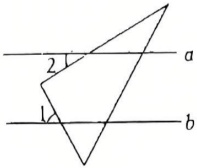

如图，直线 $a \parallel b$，将一个直角三角尺按如图所示的位置摆放，若 $\angle 1 = 58^\circ$，则 $\angle 2$ 的度数为 ( )

A. $58^{\circ}$

B. $42^{\circ}$

C. $32^{\circ}$

D. $30^{\circ}$

> [!question]- 点击查看答案与解析
> 【答案】C
> 
> 【考点】平行线的性质 → [[【初中数学知识点体系-人教版】#7-2 平行线]]
> 
> 【解析】
> 因为 $a\parallel b$，三角尺是直角三角尺（有一个角为 $90^{\circ}$）。
> $\angle 1=58^{\circ}$，根据平行线性质，$\angle 1$ 的同位角等于 $58^{\circ}$。
> 这个同位角与 $\angle 2$ 互余（直角三角尺的直角为 $90^{\circ}$）。
> $\angle 2=90^{\circ}-58^{\circ}=32^{\circ}$。
> - 选项A、B、D：计算错误；
> - 选项C：$32^{\circ}$，正确。
> 
> 【易错点】利用平行线性质转化角，再结合直角三角尺的特殊角度。
