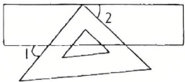

如右图，把一块直角三角尺的直角顶点放在直尺的一边上，若 $\angle2=40^{\circ}$，则 $\angle1$ 的度数为 ( )

A. $40^{\circ}$

B. $45^{\circ}$

C. $50^{\circ}$

D. $55^{\circ}$

> [!question]- 点击查看答案与解析
> 【答案】C
> 
> 【考点】平行线的性质 → [[【初中数学知识点体系-人教版】#7-2 平行线]]
> 
> 【解析】
> 直尺的两边平行，直角三角尺的直角顶点在直尺一边上。
> $\angle 2=40^{\circ}$，$\angle 1$ 与 $\angle 2$ 互余（因为直角三角尺的直角为 $90^{\circ}$）。
> $\angle 1=90^{\circ}-40^{\circ}=50^{\circ}$。
> - 选项A、B、D：计算错误；
> - 选项C：$50^{\circ}$，正确。
> 
> 【易错点】直角三角尺的两个锐角互余。
