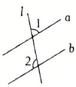

如图，直线 $l$ 分别与直线 $a，b$ 相交，若 $\angle1 = 64^{\circ}$，则当 $\angle2$ 为 ___ 时，$a \parallel b$.

> [!question]- 点击查看答案与解析
> 【答案】$116^{\circ}$
> 
> 【考点】平行线的判定 → [[【初中数学知识点体系-人教版】#7-2 平行线]]
> 
> 【解析】
> 直线 $l$ 分别与直线 $a、b$ 相交，$\angle 1=64^{\circ}$。
> 要使 $a\parallel b$，需要 $\angle 1$ 与 $\angle 2$ 是同旁内角互补或同位角相等或内错角相等。
> 从图中看，$\angle 1$ 与 $\angle 2$ 应该是同旁内角关系。
> 要使 $a\parallel b$，则 $\angle 1+\angle 2=180^{\circ}$。
> $\angle 2=180^{\circ}-64^{\circ}=116^{\circ}$。
> 
> 【易错点】判断角的位置关系（同位角、内错角、同旁内角）。
