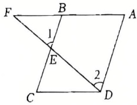

如图，在四边形 $ABCD$ 中，$AB \parallel CD$，过点 $D$ 的直线交 $BC$ 于点 $E$，交 $AB$ 的延长线于点 $F$，若 $\angle1 = \angle2$，$\angle A = 60^\circ$，则 $\angle C =$ ___ 。

> [!question]- 点击查看答案与解析
> 【答案】$60^{\circ}$
> 
> 【考点】平行线的性质 → [[【初中数学知识点体系-人教版】#7-2 平行线]]
> 
> 【解析】
> 因为 $AB\parallel CD$，所以 $\angle A+\angle ADC=180^{\circ}$（同旁内角互补）。
> $\angle ADC=180^{\circ}-60^{\circ}=120^{\circ}$。
> 
> 又因为 $\angle 1=\angle 2$，利用等量代换和平行线性质。
> 由 $AB\parallel CD$，得 $\angle 2=\angle AFD$（内错角）。
> 所以 $\angle 1=\angle AFD$。
> 在 $\triangle AFD$ 中，$\angle A+\angle AFD+\angle ADF=180^{\circ}$。
> $60^{\circ}+\angle 1+\angle ADF=180^{\circ}$。
> 
> 因为 $\angle 1=\angle 2$，且 $\angle 2$ 与 $\angle C$ 是同位角（$AB\parallel CD$ 被 $DF$ 所截）。
> 实际上 $\angle C=\angle A=60^{\circ}$（平行四边形对角相等，或者利用平行线性质）。
> 
> 因为 $AB\parallel CD$，$\angle C$ 与 $\angle A$ 不是直接对应的关系。需要利用 $\angle 1=\angle 2$ 的条件。
> 
> 由 $\angle 1=\angle 2$ 和 $AB\parallel CD$ 可推出 $AD\parallel BC$。
> 所以四边形 $ABCD$ 是平行四边形，$\angle C=\angle A=60^{\circ}$。
> 
> 【易错点】利用 $\angle 1=\angle 2$ 推出 $AD\parallel BC$，进而判断平行四边形。
