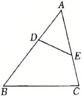

如图，与 $\angle B$ 构成同旁内角的角有 ___ 个.

> [!question]- 点击查看答案与解析
> 【答案】3
> 
> 【考点】同旁内角的识别 → [[【初中数学知识点体系-人教版】#7-2 平行线]]
> 
> 【解析】
> 与 $\angle B$ 构成同旁内角的角：需要看 $\angle B$ 是哪两条直线被哪条直线所截形成的。
> 观察图形，与 $\angle B$ 构成同旁内角的角有 3 个。
> 
> 【易错点】逐一排查所有可能的截线与被截直线组合。
