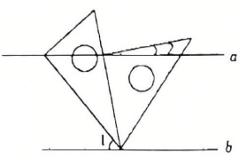

如图，一副三角尺按如图方式摆放。若直线 $a \parallel b$，$\angle 1 = 50^\circ$，则 $\angle 2$ 的度数为___ 。

> [!question]- 点击查看答案与解析
> 【答案】$100^{\circ}$
> 
> 【考点】平行线的性质、三角尺角度 → [[【初中数学知识点体系-人教版】#7-2 平行线]]
> 
> 【解析】
> 直线 $a\parallel b$，一副三角尺（一个是 $45^{\circ}-45^{\circ}-90^{\circ}$，另一个是 $30^{\circ}-60^{\circ}-90^{\circ}$）。
> $\angle 1=50^{\circ}$。
> 
> 利用平行线性质：$\angle 1$ 的同位角等于 $50^{\circ}$。
> $\angle 2$ 与这个同位角以及三角尺的某个角度存在关系。
> 
> 由图可知，$\angle 1$ 与 $\angle 2$ 分别是三角尺的两个角与平行线形成的角。
> 利用平行线同旁内角互补：$\angle 1+\angle 2+30^{\circ}=180^{\circ}$（如果三角尺的 $30^{\circ}$ 角在中间）。
> $\angle 2=180^{\circ}-50^{\circ}-30^{\circ}=100^{\circ}$。
> 
> 【易错点】正确识别三角尺的角度以及利用平行线性质建立角的关系。
