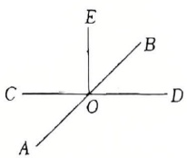

如图，直线 $AB$ 、$CD$ 相交于点 $O$ ，$EO \perp CD$ 于点 $O$ 。若 $\angle BOD : \angle BOC = 2 : 7$ ，则 $\angle AOE$ 的度数为___ 。

> [!question]- 点击查看答案与解析
> 【答案】$50^{\circ}$
> 
> 【考点】对顶角、邻补角、垂直的性质 → [[【初中数学知识点体系-人教版】#7-1 相交线]]
> 
> 【解析】
> $\angle BOD:\angle BOC=2:7$，且 $\angle BOD+\angle BOC=180^{\circ}$（邻补角）。
> 设 $\angle BOD=2x$，$\angle BOC=7x$。
> $2x+7x=180^{\circ}$，$x=20^{\circ}$。
> $\angle BOD=40^{\circ}$，$\angle BOC=140^{\circ}$。
> 
> 因为 $EO\perp CD$，所以 $\angle EOD=90^{\circ}$。
> $\angle AOE$ 与 $\angle EOD$ 的关系：$\angle AOE=\angle AOD-\angle EOD$。
> $\angle AOD=\angle BOC=140^{\circ}$（对顶角相等）。
> $\angle AOE=140^{\circ}-90^{\circ}=50^{\circ}$。
> 
> 【易错点】利用比例设未知数，结合邻补角、对顶角、垂直的性质求解。
