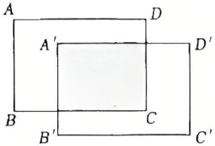

如图，将长为 6cm，宽为 4cm 的长方形 $ABCD$ 先向右平移 2cm，再向下平移 1cm，得到长方形 $A'B'C'D'$，则阴影部分的面积为 ___ cm²。

> [!question]- 点击查看答案与解析
> 【答案】14
> 
> 【考点】平移的性质、面积计算 → [[【初中数学知识点体系-人教版】#7-4 平移]]
> 
> 【解析】
> 长方形 $ABCD$ 长 6cm，宽 4cm，面积为 $6\times 4=24$ cm²。
> 向右平移 2cm，向下平移 1cm。
> 阴影部分是两个长方形各自未重叠部分的面积之和。
> 重叠部分：长 $6-2=4$cm，宽 $4-1=3$cm，面积 $4\times 3=12$ cm²。
> 向右平移 2cm 产生的阴影条面积 = $2\times 4=8$ cm²。
> 向下平移 1cm 产生的阴影条面积 = $6\times 1=6$ cm²。
> 但右下角有重叠 $2\times 1=2$ cm²（被重复计算）。
> 总阴影面积 = $8+6=14$ cm²。
> 
> 【易错点】理解阴影部分是指平移过程中"扫过"的区域，需考虑重叠部分。
