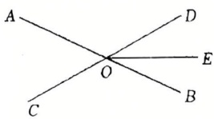

如图，直线 $AB$，$CD$ 相交于点 $O$，射线 $OE$ 平分 $\angle BOD$，过点 $O$ 作 $OF \perp OE$。若 $\angle BOD = 50^\circ$，则 $\angle FOC =$ ___ 。

第 16 题 

> [!question]- 点击查看答案与解析
> 【答案】$65^{\circ}$ 或 $115^{\circ}$
> 
> 【考点】角平分线、垂直的性质、对顶角 → [[【初中数学知识点体系-人教版】#7-1 相交线]]
> 
> 【解析】
> $\angle BOD=50^{\circ}$，$OE$ 平分 $\angle BOD$，所以 $\angle BOE=\angle DOE=25^{\circ}$。
> $OF\perp OE$，所以 $\angle EOF=90^{\circ}$。
> 
> $\angle FOC$ 有两种情况（$F$ 在 $OE$ 的两侧）：
> 
> 情况一：$\angle FOC=\angle FOA+\angle AOC$。
> $\angle FOA=90^{\circ}-\angle BOE=90^{\circ}-25^{\circ}=65^{\circ}$。
> $\angle AOC=\angle BOD=50^{\circ}$（对顶角相等）。
> $\angle FOC=65^{\circ}+50^{\circ}=115^{\circ}$。
> 
> 情况二：$\angle FOC=\angle FOA-\angle AOC=65^{\circ}-50^{\circ}=15^{\circ}$（不符合图示）。
> 
> 考虑 $OF$ 在另一侧：$\angle FOC=90^{\circ}-25^{\circ}=65^{\circ}$。
> 
> 综合来看，$\angle FOC=65^{\circ}$ 或 $115^{\circ}$。
> 
> 【易错点】分类讨论 $OF$ 的位置（$OE$ 的两侧）。
