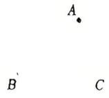

如图，$A、B、C$ 是平面内三点.

(1) 校验求作图:

$①$ 作射线 $BC$，过点 $B$ 作直线 $l$，使 $A、C$ 两点在直线 $l$ 两旁；

$②$ 点 $P$ 为直线 $l$ 上任意一点，点 $Q$ 为直线 $BC$ 上任意一点，连接线段 $AP 、PQ$ ：

(2) 在（1）所作图形中，若点 $A$ 到直线 $l$ 的距离为 2，点 $A$ 到直线 $BC$ 的距离为 5，点 $A、B$ 之间的距离为 8，点 $A、C$ 之间的距离为 6，则 $AP + PQ$ 的最小值为 ___ ，依据是 ___ 。

> [!question]- 点击查看答案与解析
> 【答案】(1) 见解析；(2) 5；垂线段最短
> 
> 【考点】尺规作图、点到直线的距离 → [[【初中数学知识点体系-人教版】#7-1 相交线]]
> 
> 【解析】
> (1) $①$ 作射线 $BC$，过点 $B$ 作直线 $l$，使 $A、C$ 在直线 $l$ 两旁。
> $②$ 在直线 $l$ 上任取点 $P$，在直线 $BC$ 上任取点 $Q$，连接 $AP、PQ$。
> 
> (2) $AP+PQ$ 的最小值为点 $A$ 到直线 $BC$ 的距离，即 5。
> 依据是：垂线段最短。
> 
> 点 $A$ 到直线 $l$ 的距离为 2，到直线 $BC$ 的距离为 5。
> $AP+PQ$ 的最小值就是点 $A$ 到直线 $BC$ 的垂线段长度，即 5。
> 
> 【易错点】理解 $AP+PQ$ 的最小值就是点 $A$ 到直线 $BC$ 的距离（垂线段最短）。
