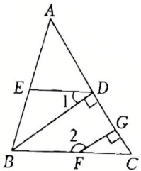

填空，完成下面的证明：

已知：如图，在三角形 ABC 中，$BD \perp AC$ 于 $D$，$FG \perp AC$ 于 $G$，且 $\angle 1 + \angle 2 = 180^\circ$。

求证：$DE \parallel BC$

证明：
$\because BD \perp AC$，$FG \perp AC$（已知），

$\therefore\angle BDC=\angle FGC=90^{\circ}$ 

∴ $BD∥FG$ ( ___ ),

$\therefore \angle2 + \angle DBC = 180^\circ$ ( ___ ),

又 $\because \angle 1 +  \angle 2 = 180^\circ$（已知），

$\therefore \angle1 = \underline{\qquad} (\underline{\qquad})$,

$\therefore DE \parallel BC (\_\_\_\_)$.

> [!question]- 点击查看答案与解析
> 【答案】见解析
> 
> 【考点】平行线的判定与性质 → [[【初中数学知识点体系-人教版】#7-2 平行线]]
> 
> 【解析】
> 证明：
> $\because BD\perp AC$，$FG\perp AC$（已知），
> $\therefore \angle BDC=\angle FGC=90^{\circ}$
> $\therefore BD\parallel FG$（同位角相等，两直线平行），
> $\therefore \angle 2+\angle DBC=180^{\circ}$（两直线平行，同旁内角互补），
> 又 $\because \angle 1+\angle 2=180^{\circ}$（已知），
> $\therefore \angle 1=\angle DBC$（同角的补角相等），
> $\therefore DE\parallel BC$（内错角相等，两直线平行）。
> 
> 【易错点】平行线的判定条件与性质条件的区别。
