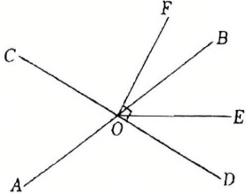

如图，直线 $AB 、CD$ 相交于点 $O$ ，$\angle AOC = 72^{\circ}$，$OE$ 平分 $\angle BOD$，$OF \perp OD$ 。求 $\angle EOF$ 的度数。

> [!question]- 点击查看答案与解析
> 【答案】$54^{\circ}$
> 
> 【考点】对顶角、角平分线、垂直的性质 → [[【初中数学知识点体系-人教版】#7-1 相交线]]
> 
> 【解析】
> $\angle AOC=72^{\circ}$，$\angle BOD=\angle AOC=72^{\circ}$（对顶角相等）。
> $OE$ 平分 $\angle BOD$，所以 $\angle BOE=\angle DOE=36^{\circ}$。
> $OF\perp OD$，所以 $\angle FOD=90^{\circ}$。
> 
> $\angle EOF=\angle FOD-\angle DOE=90^{\circ}-36^{\circ}=54^{\circ}$。
> 
> 【易错点】利用对顶角相等、角平分线定义、垂直定义逐步求解。
