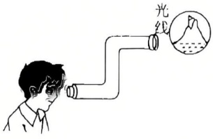
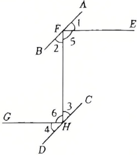

小明在利用潜望镜观察物体时发现潜望镜的工作原理如图 2 所示：两面镜了 $AB$ 和 $CD$ 足平行的，根据平面镜光的反射原理知 $\angle 1 = \angle 2，\angle 3 = \angle 4$，请据此证明进入潜望镜的光线 $EF$ 和离开潜望镜的光线 $HG$ 是平行的。

图1 

图2 

> [!question]- 点击查看答案与解析
> 【答案】见解析
> 
> 【考点】平行线的判定与性质 → [[【初中数学知识点体系-人教版】#7-2 平行线]]
> 
> 【解析】
> 证明：
> $\because AB\parallel CD$（已知），
> $\therefore \angle 2=\angle 3$（两直线平行，内错角相等）。
> 又 $\because \angle 1=\angle 2$，$\angle 3=\angle 4$（反射定律），
> $\therefore \angle 1=\angle 2=\angle 3=\angle 4$。
> 
> $\angle EFG=180^{\circ}-\angle 1-\angle 2=180^{\circ}-2\angle 2$。
> $\angle FGH=180^{\circ}-\angle 3-\angle 4=180^{\circ}-2\angle 3$。
> 
> 因为 $\angle 2=\angle 3$，所以 $\angle EFG=\angle FGH$。
> $\therefore EF\parallel HG$（内错角相等，两直线平行）。
> 
> 【易错点】利用平行线性质和反射定律建立角的关系。
