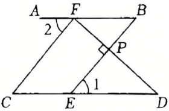

如图，$\angle2 = \angle B$，$BE$ 与 $DF$ 交于点 $P$。

(1) 若 $\angle 1 = 46^\circ$，求 $\angle C$ 的度数；

(2) 若 $\angle2 + \angle D = 90^\circ$，$AB \parallel CD$，求证：$BE \perp DF$。

> [!question]- 点击查看答案与解析
> 【答案】(1) $46^{\circ}$；(2) 见解析
> 
> 【考点】平行线的判定与性质、垂直的证明 → [[【初中数学知识点体系-人教版】#7-2 平行线]]
> 
> 【解析】
> (1) 因为 $\angle 2=\angle B$，所以 $DF\parallel AB$（同位角相等，两直线平行）。
> $\angle 1=46^{\circ}$，$\angle C=\angle 1=46^{\circ}$（两直线平行，同位角相等）。
> 
> (2) 因为 $AB\parallel CD$，所以 $\angle B+\angle C=180^{\circ}$（同旁内角互补）。
> 因为 $\angle 2=\angle B$，所以 $\angle 2+\angle C=180^{\circ}$，即 $BE\parallel DF$ 的同旁内角互补。
> 又因为 $\angle 2+\angle D=90^{\circ}$，结合 $AB\parallel CD$ 的性质可证 $\angle BPD=90^{\circ}$，即 $BE\perp DF$。
> 
> 【易错点】识别角的位置关系，利用平行线的判定和性质进行推导。
