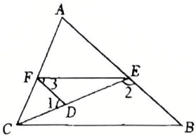

如图，在 $\triangle ABC$ 中，点 $E，F$ 分别在边 $AB，AC$ 上，点 $D$ 在 $CE$ 上，且 $\angle 1 + \angle 2 = 180^\circ$，$\angle 3 = \angle B$，若 $\angle AFE = 70^\circ$，求 $\angle ACB$ 的度数.

> [!question]- 点击查看答案与解析
> 【答案】$70^{\circ}$
> 
> 【考点】平行线的判定与性质 → [[【初中数学知识点体系-人教版】#7-2 平行线]]
> 
> 【解析】
> $\angle 1+\angle 2=180^{\circ}$，所以 $DE\parallel AF$（同旁内角互补，两直线平行）。
> $\therefore \angle 3=\angle AEF$（两直线平行，内错角相等）。
> 又 $\angle 3=\angle B$，所以 $\angle AEF=\angle B$。
> $\therefore EF\parallel BC$（同位角相等，两直线平行）。
> $\therefore \angle AFE=\angle ACB$（两直线平行，同位角相等）。
> $\because \angle AFE=70^{\circ}$，$\therefore \angle ACB=70^{\circ}$。
> 
> 【易错点】通过多步平行线的判定和性质，建立角的等量关系。
