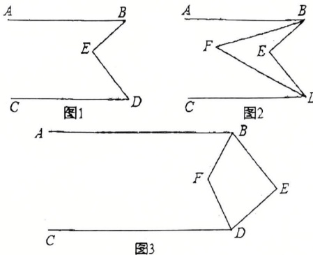

已知 $AB \parallel CD$，点 $E$ 在 $AB$ 与 $CD$ 之间.

(1) 图 1 中，证明：$\angle BED = \angle ABE + \angle CDE$；

(2) 图 2 中，$\angle ABE$ 的平分线与 $\angle CDE$ 的平分线相交于点 $F$，请利用（1）的结论证明：$\angle BED = 2\angle BFD$

(3) 图 3 中，$\angle ABE$ 与 $\angle CDE$ 的平分线相交于点 $F$，请求出 $\angle BED$ 与 $\angle BFD$ 之间的数量关系.

> [!question]- 点击查看答案与解析
> 【答案】(1) 见解析；(2) 见解析；(3) $\angle BED+2\angle BFD=360^{\circ}$
> 
> 【考点】平行线的性质、角平分线 → [[【初中数学知识点体系-人教版】#7-2 平行线]]
> 
> 【解析】
> (1) 过点 $E$ 作 $EF\parallel AB$。
> $\because AB\parallel CD$，$\therefore EF\parallel CD$（平行于同一直线的两直线平行）。
> $\therefore \angle ABE=\angle BEF$（两直线平行，内错角相等）。
> $\angle CDE=\angle DEF$（两直线平行，内错角相等）。
> $\therefore \angle BED=\angle BEF+\angle DEF=\angle ABE+\angle CDE$。
> 
> (2) 由 (1) 的结论：$\angle BED=\angle ABE+\angle CDE$。
> $BF$ 平分 $\angle ABE$，$DF$ 平分 $\angle CDE$。
> $\therefore \angle ABF=\frac{1}{2}\angle ABE$，$\angle CDF=\frac{1}{2}\angle CDE$。
> 由 (1) 同理可得 $\angle BFD=\angle ABF+\angle CDF=\frac{1}{2}\angle ABE+\frac{1}{2}\angle CDE=\frac{1}{2}(\angle ABE+\angle CDE)=\frac{1}{2}\angle BED$。
> $\therefore \angle BED=2\angle BFD$。
> 
> (3) 图 3 中，$F$ 在 $AB$ 与 $CD$ 之间但位置与图 2 不同。
> 利用类似方法：过 $E$ 作平行线，过 $F$ 作平行线。
> $\angle BED=\angle ABE+\angle CDE$（同 (1)）。
> $\angle BFD=180^{\circ}-(\angle ABF+\angle CDF)=180^{\circ}-\frac{1}{2}(\angle ABE+\angle CDE)=180^{\circ}-\frac{1}{2}\angle BED$。
> $\therefore \angle BED+2\angle BFD=360^{\circ}$。
> 
> 【易错点】作辅助平行线是解决此类问题的关键；角平分线将角分为两等份。
