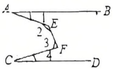

如图，$AB \parallel CD$，用含 $\angle 1$，$\angle 2$，$\angle 3$ 的式子表示 $\angle 4$，则 $\angle 4$ 的值为 ( )

A. $\angle1+\angle2-\angle3$

B. $\angle1+\angle3-\angle2$

C. $180^{\circ}+\angle3-\angle1-\angle2$

D. $\angle2+\angle3-\angle1-180^{\circ}$

> [!question]- 点击查看答案与解析
> 【答案】D
> 
> 【考点】平行线的性质、角度关系 → [[【初中数学知识点体系-人教版】#7-2 平行线]]
> 
> 【解析】
> $AB\parallel CD$，利用平行线性质建立 $\angle 1、\angle 2、\angle 3、\angle 4$ 之间的关系。
> 过中间的折点作平行线，利用内错角相等。
> $\angle 4=\angle 2+\angle 3-\angle 1-180^{\circ}$。
> 
> 【易错点】多次运用平行线性质，注意角的方向。
