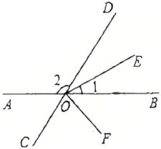

直线 $AB、CD$ 相交于点 $O$，$OE$ 平分 $\angle BOD$，$OF$ 平分 $\angle COE$，且  $\angle 1: \angle 2 = 1:4$，则 $\angle DOF$ 的度数是 ___ 。

> [!question]- 点击查看答案与解析
> 【答案】$100^{\circ}$
> 
> 【考点】角平分线、比例关系 → [[【初中数学知识点体系-人教版】#7-1 相交线]]
> 
> 【解析】
> $OE$ 平分 $\angle BOD$，设 $\angle 1=\angle BOE=x$，则 $\angle DOE=x$，$\angle BOD=2x$。
> $OF$ 平分 $\angle COE$，$\angle COE=180^{\circ}-x$。
> $\angle COF=\angle EOF=\frac{180^{\circ}-x}{2}=90^{\circ}-\frac{x}{2}$。
> 
> 由题意 $\angle 1:\angle 2=1:4$，其中 $\angle 2=\angle COF=90^{\circ}-\frac{x}{2}$。
> $\frac{x}{90^{\circ}-\frac{x}{2}}=\frac{1}{4}$，$4x=90^{\circ}-\frac{x}{2}$。
> $\frac{9x}{2}=90^{\circ}$，$x=20^{\circ}$。
> 
> $\angle DOF=\angle DOE+\angle EOF=20^{\circ}+80^{\circ}=100^{\circ}$。
> 
> 【易错点】正确识别图中 $\angle 1$ 和 $\angle 2$ 的位置，利用比例列方程。
