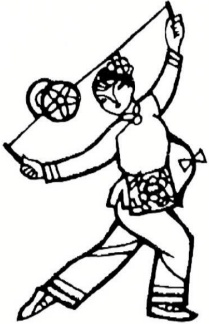
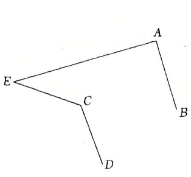

"抖空竹"经国务院批准列入第一批国家级非物质文化遗产名录“抖空竹”经国务院批准列入第一批国家级非物质文化遗产名录，“裁竹成形腰鼓如，两端绳索弄徐徐。当风急转如流水，山寺闻钟韵有余。”就是对抖空竹的写照。某同学在研究“抖空竹”时有一个发现：他把它抽象成数学问题，如图所示，已知 $\angle B \parallel CD$，$\angle BAE = 77^\circ$，$\angle DCE = 133^\circ$，则 $\angle E$ 的度数是 ___ 。

> [!question]- 点击查看答案与解析
> 【答案】$56^{\circ}$
> 
> 【考点】平行线的性质 → [[【初中数学知识点体系-人教版】#7-2 平行线]]
> 
> 【解析】
> $AB\parallel CD$，过点 $E$ 作 $EF\parallel AB$，则 $EF\parallel CD$。
> $\angle AEF+\angle BAE=180^{\circ}$（同旁内角互补），$\angle AEF=180^{\circ}-77^{\circ}=103^{\circ}$。
> $\angle CEF+\angle DCE=180^{\circ}$（同旁内角互补），$\angle CEF=180^{\circ}-133^{\circ}=47^{\circ}$。
> $\angle E=\angle AEF-\angle CEF=103^{\circ}-47^{\circ}=56^{\circ}$。
> 
> 【易错点】作辅助平行线，利用平行线性质求角。
