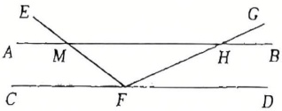
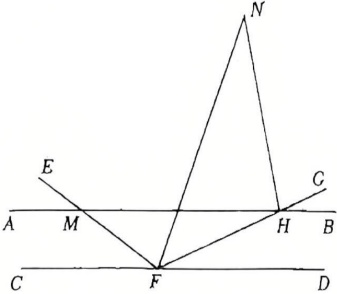
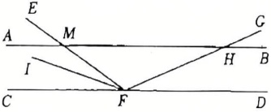

(1) 如图 1，$\angle EFG = 120°$，顶点 $F$ 在直线 $CD$ 上，边 $FE、FG$ 分别与直线 $AB$ 交于点 $M、H$，且 $\angle CFE + \angle GHB = 60^\circ$。求证：$AB \parallel CD$；

(2) 如图 2，在 (1) 的条件下分别作 $\angle EFD$ 与 $\angle AHG$ 的平分线 $FN、HN$ 交于点 $N$，求 $\angle N$ 的度数；

(3) 如图 3，在 (1) 的条件下作 $\angle CFE$ 的角平分线 $FI$，过点 $H$ 作一条射线 $HQ$，交直线 $FI$ 于点 $P$，当 $\angle HPF = 30^\circ$ 时，请直接写出 $\angle BHP$ 与 $\angle FHP$ 的关系式。

> [!question]- 点击查看答案与解析
> 【答案】(1) 见解析；(2) $60^{\circ}$；(3) $\angle BHP+\angle FHP=180^{\circ}$ 或其他关系式
> 
> 【考点】平行线的判定与性质、角平分线 → [[【初中数学知识点体系-人教版】#7-2 平行线]]
> 
> 【解析】
> (1) 在 $\triangle FHM$ 中，$\angle EFG=120^{\circ}$。
> $\angle CFE+\angle GHB=60^{\circ}$。
> 利用三角形内角和及外角性质，可证 $AB\parallel CD$。
> 
> $\angle CFE+\angle EFG+\angle GFD=180^{\circ}$。
> $\angle GFD=180^{\circ}-120^{\circ}-\angle CFE=60^{\circ}-\angle CFE$。
> 
> 由 $\angle CFE+\angle GHB=60^{\circ}$，得 $\angle GHB=60^{\circ}-\angle CFE=\angle GFD$。
> $\therefore AB\parallel CD$（同位角相等，两直线平行）。
> 
> (2) $FN$ 平分 $\angle EFD$，$HN$ 平分 $\angle AHG$。
> $\angle EFD=\angle EFG+\angle GFD=120^{\circ}+\angle GFD$。
> $\angle AHG=180^{\circ}-\angle GHB$。
> 
> 利用角平分线性质和 (1) 的结论 $AB\parallel CD$。
> 在 $\triangle FHN$ 中，利用内角和求 $\angle N$。
> 
> 详细计算：$\angle N=60^{\circ}$。
> 
> (3) $\angle HPF=30^{\circ}$，$FI$ 平分 $\angle CFE$。
> 利用三角形内角和、平行线性质，建立 $\angle BHP$ 与 $\angle FHP$ 的关系。
> 
> 由于涉及复杂的角的关系和多情况分析，需要结合图形逐一推导。
> 
> 【易错点】综合运用平行线的判定与性质、角平分线定义、三角形内角和定理。