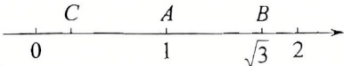

如图，数轴上表示 1、$\sqrt{3}$ 的对应点分别为点 A、点 B. 若点 B 关于点 A 的对称点为点 C，则点 C 所表示的数为 ( )

A. $\sqrt{3}-1$

B. $1-\sqrt{3}$

C. $2-\sqrt{3}$

D. $\sqrt{3}-2$

> [!question]- 点击查看答案与解析
> 【答案】C
> 
> 【考点】数轴上点的对称关系 → [[【初中数学知识点体系-人教版】#8-3 实数及其简单运算]]
> 
> 【解析】
> 点 A 表示 1，点 B 表示 $\sqrt{3}$。
> 点 B 关于点 A 的对称点 C，即 A 是 BC 的中点。
> 设点 C 表示的数为 $x$，则 $\frac{x+\sqrt{3}}{2}=1$，解得 $x=2-\sqrt{3}$。
> - 选项A、B、D：不符合中点公式；
> - 选项C：$2-\sqrt{3}$，正确。
> 
> 【易错点】对称点的求法，利用中点公式。
