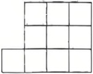
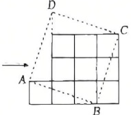
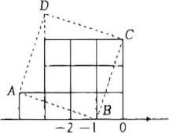

(图1) 是由 10 个边长均为 1 的小正方形组成的图形，我们沿图的虚线 AB，BC 将它剪开后，重新拼成一个大正方形 ABCD.

(1) 在图（1）中，拼成的大正方形 ABCD 的面积为 ___ ，边 $AD$ 的长为 ___ ，知识运用：

(2) 现将图（1）水平放置在如图（2）所示的数轴上，使得大正方形的顶点 B 与数轴上表示 -1 的点重合，若以点 B 为圆心，BC 边的长为半径画圆，与数轴交于点 E，求点 E 表示的数.

> [!question]- 点击查看答案与解析
> 【答案】(1) 10；$\sqrt{10}$；(2) $-1+\sqrt{10}$ 或 $-1-\sqrt{10}$
> 
> 【考点】正方形面积与边长的关系、数轴上的点 → [[【初中数学知识点体系-人教版】#8-3 实数及其简单运算]]
> 
> 【解析】
> (1) 大正方形由 10 个边长为 1 的小正方形组成，面积为 10。
> 边长 $AD=\sqrt{10}$。
> 
> (2) 点 B 表示 $-1$，以 B 为圆心，BC 为半径画圆。
> $BC=AD=\sqrt{10}$。
> 圆与数轴交于点 E，BE $=\sqrt{10}$。
> 点 E 在 B 右侧时，表示的数为 $-1+\sqrt{10}$；
> 点 E 在 B 左侧时，表示的数为 $-1-\sqrt{10}$。
> 
> 结合图中位置，点 E 在 B 右侧，故点 E 表示的数为 $-1+\sqrt{10}$。
> 
> 【易错点】数轴上点的表示方法，圆心左右两侧各有一个交点。
