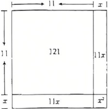

小李同学探索 $\sqrt{137}$ 的近似值的过程如下：

$\because$ 面积为 137 的正方形的边长是 $\sqrt{137}$ 且 $11<\sqrt{137}<12$，

$\therefore$ 设 $\sqrt{137}=11+x$，其中 $0<x<1$，画出示意图，如图所示. 

根据示意图，可得图中正方形的面积 $S_{正方形}=11^{2}+2\times11\cdot x+x^{2}$，

又 $\because$ $S_{正方形}=137$

$\therefore$ $11^{2} + 2 \times 11 \cdot x + x^{2} = 137$.

当 $x^{2}<1$ 时，可忽略 $x^{2}$，得 $22x+121\approx137$，得到 $x\approx0.73$，即 $\sqrt{137}\approx11.73$。

(1) 写出 $\sqrt{249}$ 的整数部分的值;

(2) 仿照上述方法，探究 $\sqrt{249}$ 的近似值。（画出示意图，标明数据，并写出求解过程）

> [!question]- 点击查看答案与解析
> 【答案】(1) 15；(2) $\sqrt{249}\approx 15.78$
> 
> 【考点】无理数的近似值估算 → [[【初中数学知识点体系-人教版】#8-3 实数及其简单运算]]
> 
> 【解析】
> (1) 因为 $15^2=225<249<256=16^2$，所以 $\sqrt{249}$ 的整数部分为 15。
> 
> (2) 设 $\sqrt{249}=15+x$，其中 $0<x<1$。
> 根据示意图，正方形面积 $S=15^2+2\times 15\cdot x+x^2=225+30x+x^2$。
> 又 $S=249$，所以 $225+30x+x^2=249$。
> 当 $x^2<1$ 时，可忽略 $x^2$，得 $30x+225\approx 249$。
> $30x\approx 24$
> $x\approx 0.8$
> 
> 所以 $\sqrt{249}\approx 15.8$。
> 
> 更精确：$x=\frac{24}{30}=0.8$。
> $\sqrt{249}\approx 15.8$。
> 
> 【易错点】理解示意图中面积分割的方法，忽略 $x^2$ 的前提条件。
