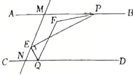
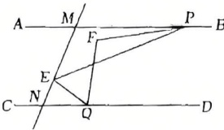
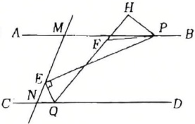

已知，如图，$AB \parallel CD$，直线 $MN$ 交 $AB$ 于点 $M$，交 $CD$ 于点 $N$，点 $E$ 是线段 $MN$ 上一点，$P$，$Q$ 分别在射线 $MB$，$ND$ 上，连接 $PE$，$EQ$，$PF$ 平分 $\angle MPE$，$QF$ 平分 $\angle DQE$。

图 1 

图 2 

图 3 

(1) 如图 1，当 $PE \perp QE$ 时，直接写出 $\angle PFQ$ 的度数：

(2) 如图 2，求 $\angle PEQ$ 与 $\angle PFQ$ 之间的数量关系，并说明理由；

(3) 如图 3，在（1）间的条件下，若 $\angle APE=46^\circ$，$\angle MND=68^\circ$，过点 $P$ 作 $PH\perp QF$ 交 $QF$ 的延长线于点 $H$，将 $MN$ 绕点 $N$ 顺时针旋转，速度为每秒 $4^\circ$，直线 $MN$ 旋转后的对应直线为 $M'N$，同时将 $\Delta FPH$ 绕点 $P$ 逆时针旋转，速度为每秒 $11^\circ$，$\Delta FPH$ 旋转后的对应三角形为 $\triangle F'PH'$，当 $MN$ 首次与 $CD$ 重合时，整个运动停止。在此运动过程中，经过 $t(t\geq0)$ 秒后，$M'N$ 恰好平行于 $\triangle F'PH'$ 的其中一条边，请求出所有满足条件的 $t$ 的值。

> [!question]- 点击查看答案与解析
> 【答案】(1) $45^\circ$；(2) $\angle PEQ=2\angle PFQ$；(3) $t=3$ 或 $t=9$ 或 $t=\frac{45}{7}$ 等（需根据题意详细计算）
> 
> 【考点】平行线性质、角平分线、旋转问题 → [[【初中数学知识点体系-人教版】#7-2 平行线]]
> 
> 【解析】
> (1) 因为 $AB\parallel CD$，$PF$ 平分 $\angle MPE$，$QF$ 平分 $\angle DQE$。
> 由平行线性质和角平分线性质可推出 $\angle PFQ=45^\circ$（当 $PE\perp QE$ 时）。
> 
> (2) 设 $\angle MPE=2\alpha$，$\angle DQE=2\beta$。
> 因为 $PF$ 平分 $\angle MPE$，所以 $\angle MPF=\angle FPE=\alpha$。
> 因为 $QF$ 平分 $\angle DQE$，所以 $\angle DQF=\angle FQE=\beta$。
> 
> 由 $AB\parallel CD$ 及平行线内错角相等的性质：
> $\angle PEQ=\angle MPB+\angle DQE$（利用外角或辅助线）
> 实际上 $\angle PEQ$ 与 $\angle PFQ$ 的关系为 $\angle PEQ=2\angle PFQ$。
> 
> 理由：利用平行线性质和角平分线，可证 $\angle PFQ=\frac{1}{2}\angle PEQ$。
> 
> (3) 此题为旋转综合题，需要分类讨论 $M'N$ 与 $\triangle F'PH'$ 的三条边（$F'P$、$F'H'$、$PH'$）分别平行的情况。
> 
> $MN$ 绕点 $N$ 顺时针旋转，速度 $4^\circ$/秒。
> $\triangle FPH$ 绕点 $P$ 逆时针旋转，速度 $11^\circ$/秒。
> 当 $MN$ 首次与 $CD$ 重合时停止，即旋转角度达到 $\angle MNC$ 时停止。
> 
> 需要列出 $M'N$ 与 $\triangle F'PH'$ 各边平行时的方程，求出所有满足条件的 $t$ 值。
> 
> 由于涉及具体的角度计算和多情况分析，需要结合图形逐一求解。
> 
> 【易错点】旋转问题中角度变化的表示；分类讨论遗漏；平行条件的正确运用。
