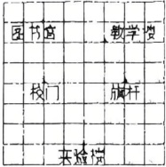

如图所示的是一所学校的平面示意图，若用 $(3,2)$ 表示教学楼，$(4,0)$ 表示旗杆，则实验楼的位置可表示成 ( )

A. $(1,-2)$

B. $(-2,1)$

C. $(-3,2)$

D. $(2,-3)$

> [!question]- 点击查看答案与解析
> 【答案】D
> 
> 【考点】平面直角坐标系中点的坐标确定 → [[【初中数学知识点体系-人教版】#9-1 用坐标描述平面内点的位置]]
> 
> 【解析】
> 由教学楼 $(3,2)$ 和旗杆 $(4,0)$ 可确定坐标系的原点、单位长度和正方向。观察图形可知，实验楼相对于教学楼的位置为横坐标减 $1$、纵坐标减 $5$，即 $(3-1, 2-5)=(2,-3)$。
> - 选项A、B、C：坐标均不符合图中位置关系；
> - 选项D：$(2,-3)$ 符合图中实验楼的位置，正确。
> 
> 【易错点】坐标系原点判断错误或单位长度把握不准确。
