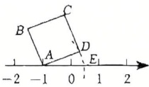

如图，面积为 3 的正方形 ABCD 的顶点 A 在数轴上，且表示的数为 -1，若 $AD = AE$，则数轴上点 E 所表示的数为 ( )

A. $\sqrt{3}-1$

B. $\sqrt{3}+1$

C. $-\sqrt{3}+1$

D. $\sqrt{3}$

> [!question]- 点击查看答案与解析
> 【答案】A
> 
> 【考点】正方形面积与边长的关系、数轴上点的表示 → [[【初中数学知识点体系-人教版】#8-3 实数及其简单运算]]
> 
> 【解析】
> 正方形面积为 3，边长 $AD=\sqrt{3}$。
> 因为 $AD=AE$，所以 $AE=\sqrt{3}$。
> 点 A 表示的数为 $-1$，点 E 在点 A 右侧（由图可知），所以点 E 表示的数为 $-1+\sqrt{3}=\sqrt{3}-1$。
> - 选项A：$\sqrt{3}-1$，正确；
> - 选项B：$\sqrt{3}+1$ 在 A 右侧更远，错误；
> - 选项C：$-\sqrt{3}+1$ 在 A 左侧，错误；
> - 选项D：$\sqrt{3}$ 未考虑 A 的起始位置，错误。
> 
> 【易错点】忽略点 A 在数轴上的起始位置为 $-1$，直接用边长作为答案。
