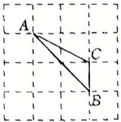

如图，点 A，B，C 都在方格纸的格点上，若点 A 的坐标为 $(-1,1)$，点 B 的坐标为 $(1,-1)$，则点 C 的坐标是 ___ .

> [!question]- 点击查看答案与解析
> 【答案】$(2,2)$
> 
> 【考点】平面直角坐标系中点的坐标确定 → [[【初中数学知识点体系-人教版】#9-1 用坐标描述平面内点的位置]]
> 
> 【解析】
> 由点 $A(-1,1)$ 和点 $B(1,-1)$ 可确定坐标系的原点和单位长度。
> 观察方格图，从 A 到 B：横坐标从 $-1$ 到 $1$（右移 2 格），纵坐标从 $1$ 到 $-1$（下移 2 格）。
> 所以每格代表 1 个单位长度。
> 从 A 出发到 C：右移 3 格（横坐标 $-1+3=2$），上移 1 格（纵坐标 $1+1=2$）。
> 故点 C 的坐标为 $(2,2)$。
> 
> 【易错点】坐标系原点或单位长度判断错误。
