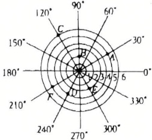

如图，雷达探测器测得 $A, B, C, D, F, F$ 六个目标。按照规定的目标表示方法，目标 $B, C$ 的位置分别表示为 $(2,90^{\circ})$ 和 $(6,120^{\circ})$，那么，目标 $F$ 表示为 ___ 。

> [!question]- 点击查看答案与解析
> 【答案】$(5,300^{\circ})$
> 
> 【考点】极坐标表示法 → [[【初中数学知识点体系-人教版】#9-1 用坐标描述平面内点的位置]]
> 
> 【解析】
> 根据目标表示方法，$(r,\theta)$ 中 $r$ 表示距离（圈数），$\theta$ 表示角度。
> 由图可知，F 在第 5 圈上，角度为 $300^{\circ}$（从正东方向逆时针测量）。
> 故目标 F 表示为 $(5,300^{\circ})$。
> 
> 【易错点】圈数数错或角度判断错误。
