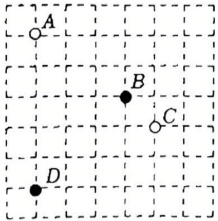

围棋起源于中国，古代称为“弈”，是棋类鼻祖，距今已有4000多年的历史。如图是某围棋棋盘的局部，若棋盘是由边长均为1的小正方形组成的，棋盘上A、B两颗棋子的坐标分别为 $A(-2,4)$，$B(1,2)$。

(1) 根据题意，画出相应的平面直角坐标系：

(2) 分别写出 C、D 两颗棋子的坐标：

(3) 有一颗黑色棋子 E 的坐标为 $(3,-1)$，请在图中画出黑色棋子 E.

> [!question]- 点击查看答案与解析
> 【答案】(1) 见解析；(2) $C(3,1)$，$D(-1,1)$（具体坐标需根据图中位置确定）；(3) 见解析
> 
> 【考点】平面直角坐标系的建立、点的坐标确定 → [[【初中数学知识点体系-人教版】#9-1 用坐标描述平面内点的位置]]
> 
> 【解析】
> (1) 根据 $A(-2,4)$ 和 $B(1,2)$ 确定坐标系：
> - 由 A 的坐标可知，原点在 A 右侧 2 格、下方 4 格的位置；
> - 由 B 的坐标可知，原点在 B 左侧 1 格、上方 2 格的位置；
> - 两者确定的原点应一致，据此画出 x 轴和 y 轴。
> 
> (2) 根据建立的坐标系，读取 C、D 的坐标。
> 由图中网格位置关系确定（需结合图形）。
> 
> (3) 在图中标出 $(3,-1)$ 的位置，即原点右侧 3 格、下方 1 格。
> 
> 【易错点】坐标系原点确定错误；网格单位长度把握不准确。
