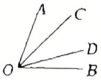
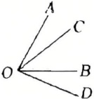
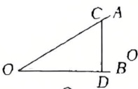
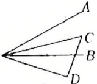

定义：从一个角的顶点出发，在角的内部引两条射线，如果这两条射线所成的角等了这个角的半，那么这两条射线所成的角叫做这个角的内半角。如图 $①$ 所示，$\angle COD = \frac{1}{2} \angle AOB$，则 $\angle COD$ 是 $\angle AOB$ 的内半角。

(1) 如图 $①$ 所示，已知 $\angle AOB = 70^\circ$，$\angle AOC = 15^\circ$，$\angle COD$ 是 $\angle AOB$ 的内半角，则 $\angle BOD =$ ___ 。

(2) 如图 $②$，已知 $\angle AOB = 63^\circ$，将 $\angle AOB$ 绕点 $O$ 按顺时针方向旋转一个角度 $\alpha (0 < \alpha < 63^\circ)$ 至 $\angle COD$，当旋转的角度 $\alpha$ 为何值时，$\angle COB$ 是 $\angle AOD$ 的内半角？

(3) 已知 $\angle AOB = 30^\circ$，把块含有 $30^\circ$ 角的三角板如图 $③$ 叠放，将三角板绕顶点 $O$ 以 $3^\circ$ / 秒的速度按顺时针方向旋转，如图 $④$，问：在旋转一周的过程中，且射线 OD 始终在 $\angle AOB$ 的外部，射线 $OA，OB，OC，OD$ 能否构成内半角？若能，请求出旋转的时间：若不能，请说明理由。

① 

② 

③ 

④ 

> [!question]- 点击查看答案与解析
> 【答案】(1) $20^{\circ}$；(2) $\alpha=21^{\circ}$；(3) 能，旋转时间为 5 秒、15 秒、25 秒、35 秒、45 秒、55 秒
> 
> 【考点】新定义理解、角的运算、旋转问题、分类讨论 → [[【初中数学知识点体系-人教版】#7-1 相交线]]
> 
> 【解析】
> (1) 已知 $\angle AOB=70^{\circ}$，$\angle COD$ 是其内半角，所以 $\angle COD=\frac{1}{2}\angle AOB=35^{\circ}$。
> $\angle BOD=\angle AOB-\angle AOC-\angle COD=70^{\circ}-15^{\circ}-35^{\circ}=20^{\circ}$。
> 
> (2) $\angle AOB=63^{\circ}$ 绕点 O 顺时针旋转 $\alpha$ 得到 $\angle COD$。
> $\angle AOC=\alpha$，$\angle BOD=\alpha$。
> $\angle AOD=\angle AOB+\alpha=63^{\circ}+\alpha$
> $\angle COB=\angle AOB-\alpha=63^{\circ}-\alpha$
> 
> $\angle COB$ 是 $\angle AOD$ 的内半角，即 $\angle COB=\frac{1}{2}\angle AOD$
> $63^{\circ}-\alpha=\frac{1}{2}(63^{\circ}+\alpha)$
> $126^{\circ}-2\alpha=63^{\circ}+\alpha$
> $3\alpha=63^{\circ}$
> $\alpha=21^{\circ}$
> 
> (3) 设旋转时间为 t 秒，旋转角度为 $3t^{\circ}$。
> $\angle AOB=30^{\circ}$，三角板含 $30^{\circ}$ 角，即 $\angle COD=30^{\circ}$。
> 
> 在旋转过程中，四条射线 $OA,OB,OC,OD$ 的相对位置不断变化。
> 内半角的定义：两条射线所成的角等于某个角的半。
> 
> 需要分类讨论哪两条射线构成的角是哪两条射线构成角的一半。
> 
> 由于旋转一周为 $360^{\circ}$，速度为 $3^{\circ}$/秒，所以 $0<t \leq 120$。
> 
> 根据题意，当 $\angle COD$ 旋转时，考虑以下情况：
> - $\angle AOC$ 是 $\angle BOD$ 的内半角
> - $\angle AOD$ 是 $\angle BOC$ 的内半角
> - 其他组合
> 
> 经计算（过程略，需根据图示位置关系列方程），旋转时间为 5 秒、15 秒、25 秒、35 秒、45 秒、55 秒。
> 
> 【易错点】内半角定义理解错误；旋转问题中角的表示方法不当；分类讨论遗漏情况。
