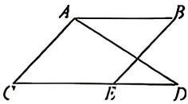

如图，下列能判断 $AB \parallel CD$ 的是

(A) $\angle B + \angle CAB = 180^\circ$

(B) $\angle C = \angle B$

(C) $\angle C = \angle BED$

(D) $\angle B = \angle BED$

> [!question]- 点击查看答案与解析
> 【答案】D
> 
> 【考点】平行线判定 → [[【初中数学知识点体系-人教版】#7-2 平行线]]
> 
> 【解析】$\angle B=\angle BED$，内错角相等$\Rightarrow AB\parallel CD$。
> 
> 【易错点】分不清被截直线；判定定理与性质定理混淆。
