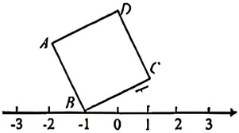

如图，面积为 5 的正方形 ABCD 的顶点 B 在数轴上，且点 B 表示的数为 -1，以点 B 为圆心，BC 长为半径画弧，与正半轴的交点为 P，则点 P 表示的数为

(A) $-1-\sqrt{5}$

(B) $\sqrt{5}+1$

(C) $-1+\sqrt{5}$

(D) $\sqrt{5}$

> [!question]- 点击查看答案与解析
> 【答案】C
> 
> 【考点】正方形面积、数轴上的点 → [[【初中数学知识点体系-人教版】#8-3 实数及其简单运算]]
> 
> 【解析】正方形面积为$5$，边长$BC=\sqrt{5}$；点$B$表示$-1$，点$P=-1+\sqrt{5}$。
> 
> 【易错点】边长与面积概念混淆；数轴移动方向算反。
