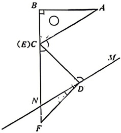

把一副直角三角尺按如图方式摆放，$60^{\circ}$ 角的顶点 C 与 $45^{\circ}$ 角的顶点 E 重合，BC 边与 EF 边在同一直线上，若直线 $MN \parallel AC$ ，且 MN 经过点 D，则 $\angle FDN$ 的度数为 ___ .

> [!question]- 点击查看答案与解析
> 【答案】$75^\circ$
> 
> 【考点】平行线性质、三角尺角度 → [[【初中数学知识点体系-人教版】#7-2 平行线]]
> 
> 【解析】$MN\parallel AC\Rightarrow\angle MDE=60^\circ$，$\angle FDN=180^\circ-60^\circ-45^\circ=75^\circ$。
> 
> 【易错点】三角尺角度记错；平行线性质用错。
