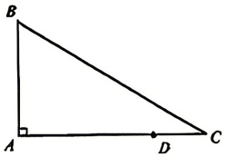

如图，在三角形 ABC 中，$\angle A = 90^\circ$ ，$\angle B = 60^\circ$ ，$\angle C = 30^\circ$ ，点 D 是线段 AC 上一点，按要求完成下列问题。

(1) 过点 A 作 BC 垂线段，垂足为 E；过点 D 作 DF∥AB 交 BC 于点 F，连接 AF；

(2) 比较线段 AF 和 AE 的大小，AF ___ AE（填“＞”，“＜”或“＝”），判断的依据是 ___ ；

(3) 如果 $\angle FAD=20^\circ$，那么 $\angle BFA$ 的度数为 ___ .

> [!question]- 点击查看答案与解析
> 【答案】(1) 略；(2)$>$，垂线段最短；(3)$80^\circ$
> 
> 【考点】作图、垂线段最短 → [[【初中数学知识点体系-人教版】#7-1 相交线]]
> 
> 【解析】
> (1) 过$A$作$AE\perp BC$，过$D$作$DF\parallel AB$交$BC$于$F$，连接$AF$。
> (2) $AE$是垂线段，$AF$是斜线段，由**垂线段最短**得$AF>AE$。
> (3) $\angle BAC=90^\circ$，$\angle FAD=20^\circ$，$\angle BAF=70^\circ$，$\angle B=60^\circ$，
> $\angle BFA=180^\circ-60^\circ-70^\circ=80^\circ$。
> 
> 【易错点】作图不规范；角度关系找错。
