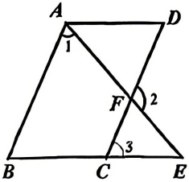

如图，在四边形 $ABCD$ 中，点 $F$ 在线段 $CD$ 上，射线 $AF$ 与 $BC$ 延长线交于点 $E$ ，若 $\angle1 + \angle2 = 180^\circ$ ，$\angle B = \angle D$ 。求证：$AD \parallel BE$.

证明：
$\because \angle1 + \angle2 = 180^{\circ}$

$\angle2 = \angle AFC$ ( ___ )

$\therefore \angle1 + \angle AFC = 180^{\circ}$

$\therefore$ \_\_\_\_ // CD ( ___ )

$\therefore \angle B = \angle 3$ ( ___ )

$\because \angle B = \angle D$

$\therefore \angle D = \angle 3$

$\therefore AD \parallel BE$ ( ___ )

> [!question]- 点击查看答案与解析
> 【答案】对顶角相等；$AB$；同旁内角互补，两直线平行；两直线平行，同位角相等；内错角相等，两直线平行
> 
> 【考点】平行线判定与性质 → [[【初中数学知识点体系-人教版】#7-2 平行线]]
> 
> 【解析】
> $\because\angle1+\angle2=180^\circ$
> $\angle2=\angle AFC$（**对顶角相等**）
> $\therefore\angle1+\angle AFC=180^\circ$
> $\therefore AB\parallel CD$（**同旁内角互补，两直线平行**）
> $\therefore\angle B=\angle3$（**两直线平行，同位角相等**）
> $\because\angle B=\angle D$
> $\therefore\angle D=\angle3$
> $\therefore AD\parallel BE$（**内错角相等，两直线平行**）
> 
> 【易错点】判定与性质混淆；理由填写错误。
