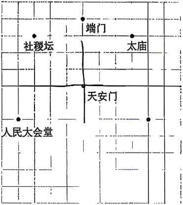

2024年7月27日，“北京中轴线——中国理想都城秩序的杰作”被正式列入《世界遗产名录》。北京中轴线是一组自南向北贯穿北京老城，由一系列建筑与空间构成的宏大建筑群。从南至北由15处核心遗产点构成，呈严格对称，居中纵贯的网格分布。五一小长假，某班组织中轴线北线的探秘之旅，在出发前，每位同学拿到了如下图所示的用坐标表示中轴线几处核心遗产点的示意图，已知人民大会堂的坐标是 $(-4,-2)$ ，端门的坐标是 $(0,4)$ 。

(1) 请根据题意在图上建立平面直角坐标系;

(2) 在 (1) 的条件下，写出太庙的坐标为 ___ ；

(3) 甲同学给在人民大会堂的乙同学发消息说：“我在人民英雄纪念碑，就是你的东南方向。” 甲同学又告诉在国家博物馆的丙同学：“我在你的西南方向。”请你根据这些信息：

$①$ 用点 A 在图上表示人民英雄纪念碑的位置；

$②$ 在 (1) 的条件下，A 点坐标为 ___ .

> [!question]- 点击查看答案与解析
> 【答案】(1) 略；(2)$(2,2)$；(3) $①$ 略；$②$$(0,-1)$
> 
> 【考点】坐标系建立、坐标确定 → [[【初中数学知识点体系-人教版】#9-1 用坐标描述平面内点的位置]]
> 
> 【解析】
> (1) 以中轴线为$y$轴，水平为$x$轴，原点在中心位置。
> (2) 太庙坐标为$(2,2)$。
> (3) 人民英雄纪念碑在人民大会堂东南、国家博物馆西南，坐标为$(0,-1)$。
> 
> 【易错点】坐标系建错；方位判断错误。
