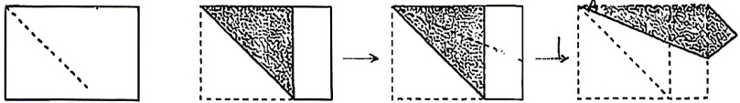

阅读理解：
学习了实数这一章后，我们可以用折纸的方法研究 B0 纸的边长之间的关系，将 B0 纸按下图所示的方式折叠，可以得到 B0 纸的长与宽的比例关系，请你观察图片，写出 B0 纸长:宽= ___ ；已知 B0 纸的宽是 1 米，则 B0 纸的面积是 ___ 平方米.

按照国际标准，B 系列纸为长方形，将 B0 纸沿长边对折、裁开便成 B1 纸；将 B1 纸沿长边对折、裁开便成 B2 纸，将 B2 纸沿长边对折、裁开便成 B3 纸……按照这样的规律，B5 纸的面积是 ___ 平方米.

> [!question]- 点击查看答案与解析
> 【答案】$\sqrt{2}:1$；$\sqrt{2}$；$\dfrac{\sqrt{2}}{32}$
> 
> 【考点】折叠、面积递推 → [[【初中数学知识点体系-人教版】#8-3 实数及其简单运算]]
> 
> 【解析】
> B0纸折叠后长:宽$=\sqrt{2}:1$；宽$1$米，则长$\sqrt{2}$米，面积$\sqrt{2}$；
> 每对折一次面积减半，B5对折$5$次，面积$=\sqrt{2}\times\left(\dfrac12\right)^5=\dfrac{\sqrt{2}}{32}$。
> 
> 【易错点】比例推导错误；对折次数算错。
