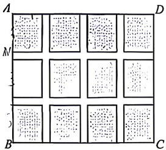

列方程(组)解应用题
如图，学校规划在一块长 19 米，宽 17 米的长方形场地 ABCD 上，分别设计与 AD，AB 平行的横向和纵向通道，把这块长方形地分成 12 块形状、大小相同的长方形菜地分给各班管理。如果通道的宽度相等，其中一块菜地的两边 $AM:AN = 4:5$，那么通道的宽度是多少？

> [!question]- 点击查看答案与解析
> 【答案】通道宽度为$1$米
> 
> 【考点】方程组应用 → [[【初中数学知识点体系-人教版】#10-3 实际问题与二元一次方程组]]
> 
> 【解析】
> 设通道宽为$x$米，菜地边长为$4k$、$5k$。
> 由题意得：
> $\begin{cases}16k+3x=19\\15k+2x=17\end{cases}$
> 解得$k=1$，$x=1$。
> 答：通道宽度为$1$米。
> 
> 【易错点】等量关系列错；方程组解错。
