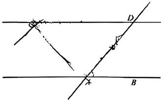
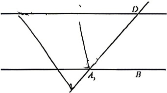

如图，$AB \parallel CD$ ，AD 平分 $\angle CAB$ ，过 A 作 $AD \perp AE$ ，交直线 CD 于点 E，点 F 在直线 AD 上（点 F 不与 A、D 重合），连接 EF.

(1) 若 EF 平分 $\angle AED$，$\angle ACE = 112^{\circ}$，

$①$ 根据题意在图 1 中补全图形；

$②$ 求出 $\angle AFE$ 的度数.

(2) 设 $\angle ACE = \alpha$ ，当点 F 在直线 AD 上运动时，直接写出 $\angle DEF$ 与 $\angle AFE$ 的数量关系（用含 $\alpha$ 的式子表示）

图 1 

备用图 

> [!question]- 点击查看答案与解析
> 【答案】(1) $②$$28^\circ$；(2)$\angle AFE=\dfrac{\alpha}{2}-45^\circ$
> 
> 【考点】平行线性质、角平分线、垂直 → [[【初中数学知识点体系-人教版】#7-2 平行线]]
> 
> 【解析】
> (1) $\angle ACE=112^\circ\Rightarrow\angle CAB=68^\circ$，$AD$平分$\angle CAB\Rightarrow\angle CAD=34^\circ$，
> $AD\perp AE\Rightarrow\angle DAE=90^\circ\Rightarrow\angle AED=56^\circ$，
> $EF$平分$\angle AED\Rightarrow\angle AFE=28^\circ$。
> (2) 设$\angle ACE=\alpha$，则$\angle BAC=180^\circ-\alpha$，
> $\angle CAE=90^\circ+\dfrac{180^\circ-\alpha}{2}$，
> 得$\angle AFE=\dfrac{\alpha}{2}-45^\circ$。
> 
> 【易错点】角度关系混乱；忽略角平分线与垂直的组合条件。
