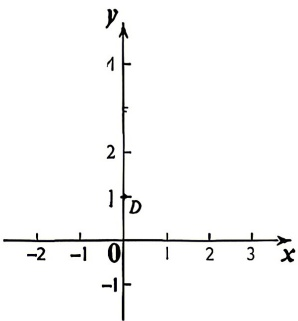
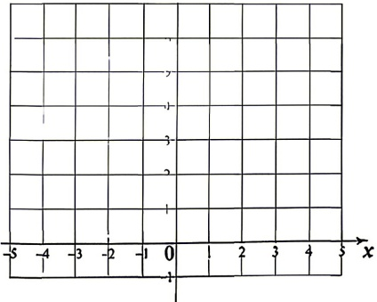

在平面直角坐标系中，对于任意两点 $P(x_1, y_1)$ 与 $Q(x_2, y_2)$ 的“美好距离”，给出如下定义：

若 $|x_1 - x_2| \geq |y_1 - y_2|$ ，则点 $P$ 与点 $Q$ 的“美好距离”为 $|x_1 - x_2|$ ：

若 $|x_1 - x_2| < |y_1 - y_2|$ ，则点 $P$ 与点 $Q$ 的“美好距离”为 $|y_1 - y_2|$ 。

用符号 $M_{PQ}$ 表示 $P, Q$ 两点的“美好距离”。

(1) 已知点 $A(\frac{1}{2}, 0)$ ，$B$ 为 $y$ 轴上的一个动点，

$①$ 若点 $A$ 与点 $B$ 的“美好距离”为 2，满足条件的点 $B$ 的坐标是 ___ （写出 1 个即可）：

$②$ 点 A 与点 B 的“美好距离”的最小值是 ___ ；

(2) 已知直线 $l$ 过 $(2,3)$ 且平行于 $x$ 轴，C 是直线 $l$ 上的一个动点，如图 1，点 D 的坐标是 $(0,1)$ ，则点 C 与点 D 的“美好距离”的最小值是 ___ ；当 C 与 D 的“美好距离”取最小值时，点 C 的横坐标的最小值是 ___ ；

(3)已知 $E(\uparrow-1,0)$ ，$F(t-3,4)$ ，定义平面内的一个动点 $P$ 满足 $M_{F\uparrow} = M_{F\uparrow} + M_{F\uparrow}$ ，则称动点 $P$ 为 $E$ ，$F$ 两点间的“美好连接点”.

$①$ 若 $t=-1$，请在图 2 中画出 E, F 两点间的“美好连接点”所覆盖的区域：

$②$ 已知 N 点坐标为 $(\frac{l}{4}, 0)$ ，直线 $a$ 过点 N 且垂直于 $x$ 轴，直接写出当直线 $a$ 上存在 E, F 两点间“美好连接点”时, $t$ 的最大值.

图 1 

图 2 

> [!question]- 点击查看答案与解析
> 【答案】(1) $①$$(0,2)$；$②$$\dfrac12$；(2)$2$，$-2$；(3) $②$$\dfrac{17}{4}$
> 
> 【考点】新定义"美好距离" → [[【初中数学知识点体系-人教版】#9-1 用坐标描述平面内点的位置]]
> 
> 【解析】
> 定义：$|x_1-x_2|\ge|y_1-y_2|$时取横坐标差，否则取纵坐标差。
> (1) $①$ $B(0,2)$满足"美好距离"$2$；$②$最小值为$\dfrac12$。
> (2) $C$在$y=3$上，$D(0,1)$，最小值为$2$，此时$C$横坐标最小为$-2$。
> (3) 由"美好连接点"定义，直线$x=\dfrac{t}{4}$上存在满足条件的点，
> 得$t$最大值为$\dfrac{17}{4}$。
> 
> 【易错点】新定义理解错误；最值判断错误；参数范围算错。
