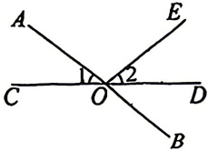

如图，直线 AB，CD 相交于点 O。若 $\angle 1 = \angle 2 = 40^{\circ}$，则 $\angle BOE$ 的度数是

A. $40^{\circ}$

B. $60^{\circ}$

C. $80^{\circ}$

D. $100^{\circ}$

> [!question]- 点击查看答案与解析
> 【答案】D
> 
> 【考点】邻补角、角度计算 → [[【初中数学知识点体系-人教版】#7-1 相交线]]
> 
> 【解析】两条直线相交，邻补角之和为$180^{\circ}$。
> 已知$\angle 1=\angle 2=40^{\circ}$，则$\angle DOE=80^{\circ}$，
> $\angle BOE=180^{\circ}-\angle DOE=180^{\circ}-80^{\circ}=100^{\circ}$。
> 
> 【易错点】邻补角性质记忆错误；角度加减计算失误。
