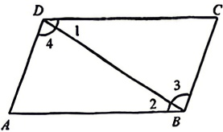

如图，下列推理中正确的是

A. 若 $\angle 1 = \angle C$，则 $AD \parallel BC$

B. 若 $\angle 1 = \angle 2$，则 $AB \parallel DC$

C. 若 $\angle A = \angle 3$，则 $AD \parallel BC$

D. 若 $\angle 3 = \angle 4$，则 $AB \parallel DC$

> [!question]- 点击查看答案与解析
> 【答案】D
> 
> 【考点】平行线判定 → [[【初中数学知识点体系-人教版】#7-2 平行线]]
> 
> 【解析】平行线判定：同位角相等、内错角相等、同旁内角互补，两直线平行。
> - A：$\angle 1=\angle C$，判定$AB\parallel DC$；
> - B：$\angle 1=\angle 2$，判定$AD\parallel BC$；
> - C：$\angle A=\angle 3$，判定$AD\parallel BC$；
> - D：$\angle 3=\angle 4$，内错角相等，判定$AB\parallel DC$。
> 
> 【易错点】混淆内错角、同位角对应的平行直线；判定定理记忆混淆。
