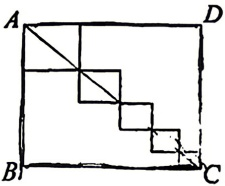

如图，长方形 ABCD 的长 BC = 5，宽 AB = 4，则图中长方形 ABCD 内部的五个小长方形的周长之和为

A. 9

B. 13

C. 14

D. 18

> [!question]- 点击查看答案与解析
> 【答案】D
> 
> 【考点】平移法求周长 → [[【初中数学知识点体系-人教版】#9-2 坐标方法的简单应用]]
> 
> 【解析】利用平移思想，所有小长方形的水平边之和$=2\times BC$，竖直边之和$=2\times AB$。
> 总周长和$=2\times5 + 2\times4=18$。
> 
> 【易错点】直接数边导致重复/遗漏；不会使用平移法简化计算。
