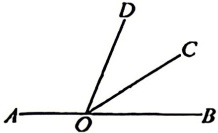

如图，点 O 在直线 AB 上，射线 OC 平分 ∠DOB，若 $\angle DOC = 35^{\circ}$，则 $\angle AOD$ = ___ 。

> [!question]- 点击查看答案与解析
> 【答案】$110^\circ$
> 
> 【考点】角平分线、邻补角 → [[【初中数学知识点体系-人教版】#7-1 相交线]]
> 
> 【解析】$OC$平分$\angle DOB$，$\angle DOB=2\angle DOC=70^\circ$，
> $\angle AOD$与$\angle DOB$互为邻补角，$\angle AOD=180^\circ-70^\circ=110^\circ$。
> 
> 【易错点】角平分线性质应用错误；邻补角之和记为$90^\circ$。
