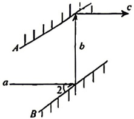

如图，已知平面镜 $A$ 平行于平面镜 $B$，光线由水平方向射来，传播路线为 $a \to b \to c$，$a \perp b$，$b \perp c$，若 $\angle 1 = 34^\circ$，则 $\angle 2 =$ ___ 。

> [!question]- 点击查看答案与解析
> 【答案】$34^\circ$
> 
> 【考点】平行线性质、光反射 → [[【初中数学知识点体系-人教版】#7-2 平行线]]
> 
> 【解析】平面镜$A\parallel B$，根据光的反射定律（入射角=反射角），结合平行线内错角相等，得$\angle 2=\angle 1=34^\circ$。
> 
> 【易错点】不理解反射规律；平行线性质应用错误。
