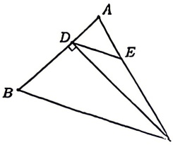

按要求完成下列的证明：

已知：如图，$CD \perp AB$ 于点 $D$，$E$ 是 $AC$ 上一点，$\angle ADE + \angle DCB = 90^\circ$。
求证：DE//BC.

证明：$\because CD \perp AB$（已知）

$\therefore \angle ADE + \_\_\_\_\_ = 90^\circ$（依据：\_\_\_\_\_）

$\because \angle ADE + \angle DCB = 90^\circ$（已知）

$\therefore$ ___ $= \angle DCB$（依据：___ ）

$\therefore DE \parallel BC$（依据：___ ）

> [!question]- 点击查看答案与解析
> 【答案】$\angle CDE$；垂直的定义；$\angle CDE$；同角的余角相等；内错角相等，两直线平行
> 
> 【考点】垂直定义、平行线判定 → [[【初中数学知识点体系-人教版】#7-1 相交线]]
> 
> 【解析】
> $\because CD \perp AB$（已知）
> $\therefore \angle ADE + \angle CDE = 90^\circ$（垂直的定义）
> $\because \angle ADE + \angle DCB = 90^\circ$（已知）
> $\therefore \angle CDE = \angle DCB$（同角的余角相等）
> $\therefore DE \parallel BC$（内错角相等，两直线平行）
> 
> 【易错点】几何依据填写错误；角度对应错误。
