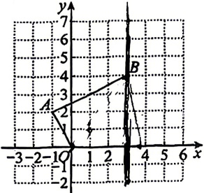

如图，在平面直角坐标系中，点 $A(-1, 2)$，$B(3, 4)$，三角形 $ABO$ 经平移得到三角形 $A_{1}B_{1}O_{1}$，且点 $A、B、O$ 的对应点分别为 $A_{1}$、$B_{1}$、$O_{1}$。已知 $P(a, b)$ 是线段 AB 上一点，$A_{1}(-2, 5)$。

(1) 画出三角形 $A_{1}B_{1}O_{1}$;

(2) 写出 B, P 的对应点 $B_{1}$, $P_{1}$ 的坐标;

$B_{1}\left(\_\_\_\_\_\_\right)$，$P_{1}\left(\_\_\_\_\_\_\right)$;

(3) 若点 $M(3, m)$，且三角形 $OMB$ 的面积为 9，直接写出满足条件的点 $M$ 的坐标 ___ .

> [!question]- 点击查看答案与解析
> (1)
> 【答案】作图略（向左平移1个单位，向上平移3个单位）
> 
> 【考点】平移作图、坐标变化 → [[【初中数学知识点体系-人教版】#9-2 坐标方法的简单应用]]
> 
> 【解析】由$A(-1,2)\to A_1(-2,5)$，得平移规律：横坐标$-1$，纵坐标$+3$。
> 
> 【易错点】平移方向、距离判断错误。
> 
> (2)
> 【答案】$B_1(2,7)$；$P_1(a-1,b+3)$
> 
> 【考点】平移作图、坐标变化 → [[【初中数学知识点体系-人教版】#9-2 坐标方法的简单应用]]
> 
> 【解析】根据平移规则，点的坐标同步变化。
> 
> 【易错点】平移坐标规律记忆错误。
> 
> (3)
> 【答案】$(3,10)$或$(3,-2)$
> 
> 【考点】平移作图、坐标变化 → [[【初中数学知识点体系-人教版】#9-2 坐标方法的简单应用]]
> 
> 【解析】$\dfrac{1}{2} \times 3 \times |m-4|=9$，解得$|m-4|=6$，$m=10$或$-2$。
> 
> 【易错点】绝对值方程漏解；面积公式遗漏$\dfrac{1}{2}$。
