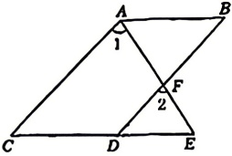

如图，线段 AE 与 BD 相交于点 F，点 D 在线段 CE 上，$AB \parallel CE$，$\angle B = \angle C$。求证：$\angle 1 = \angle 2$。

> [!question]- 点击查看答案与解析
> 【答案】完整证明见解析
> 
> 【考点】平行线性质与判定 → [[【初中数学知识点体系-人教版】#7-2 平行线]]
> 
> 【解析】
> $\because AB\parallel CE$，$\therefore \angle B=\angle CDE$
> $\because \angle B=\angle C$，$\therefore \angle CDE=\angle C$
> $\therefore AC\parallel BD$，$\therefore \angle 1=\angle 2$
> 
> 【易错点】平行线性质与判定混淆；逻辑推导不完整。
