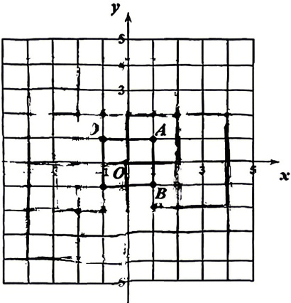

在平面直角坐标系 $xOy$ 中，对于 $P(x, y)$ 给出如下定义：

$①$ 记 $Q\left(\frac{x}{2}, -y\right)$ 是 $P^{\prime}$ 的”半影点”，例如 $O(0, 0)$ 的”半影点”是它自己，

$②$ 对平面两点 $A_{1}(x_{1}, y_{1}), B_{1}(x_{2}, y_{2}), 记\quad d_{x}=\left|x_{1}-x_{2}\right|, \quad d_{y}=\left|y_{1}-y_{2}\right|$

如果 $\left|d_{x}-d_{y}\right|=1$ 称 $A$ 和 $B$ 为”单位邻点”，例如 $O(0,0)$ 和 $P(1,0)$ 是”单位邻点”。

(1) 已知 $P(8, \frac{\pi}{2})$，点 Q 是点 P 的”半影点”，

$①$ 点 Q 的坐标是 ___ ；

$②$ 下列三个点中，是 Q 的”单位邻点”的有 ___ （填字母）；

A $(1, 0)$

B $(3, -1)$

C $(-2, 2)$

$③$ 若点 D 在 y 轴上，且 D 的半影点与 P 是 "单位邻点"，直接写出 D 的坐标.

(2) 如图，四边形 ABCD 是以原点为中心的边长为 2，且四边分别与坐标轴平行的正方形.

$①$ 请直接在图中画出点 A 的所有单位邻点组成的图形；

$②$ 对于一个四边分别与坐标轴平行的正方形 EFGH，如果正方形 EFGH 边上的任何一点，其”半影点”都可以在四边形 ABCD 的边上找到其单位邻点，直接写出正方形 EFGH 的面积的最大值为 ___ .

> [!question]- 点击查看答案与解析
> (1) $①$
> 【答案】$\left(4,\ -\dfrac{\pi}{2}\right)$
> 
> 【考点】新定义（半影点、单位邻点） → [[【初中数学知识点体系-人教版】#9-1 用坐标描述平面内点的位置]]
> 
> 【解析】已知点$P\left(8,\dfrac{\pi}{2}\right)$，根据**半影点定义**：
> 横坐标：$8\div2=4$；
> 纵坐标：$-\dfrac{\pi}{2}$；
> 因此半影点$Q$的坐标为$\left(4,\ -\dfrac{\pi}{2}\right)$。
> 
> 【易错点】半影点变换规则记错（纵坐标未取反/横坐标未减半）；计算失误。
> 
> (1) $②$
> 【答案】A
> 
> 【考点】新定义（半影点、单位邻点） → [[【初中数学知识点体系-人教版】#9-1 用坐标描述平面内点的位置]]
> 
> 【解析】已知$P\left(8,\dfrac{\pi}{2}\right)$，半影点$Q\left(4,-\dfrac{\pi}{2}\right)$，逐一验证选项：
> 设$d_x=|x_Q - x_{\text{点}}|$，$d_y=|y_Q - y_{\text{点}}|$，判定$|d_x-d_y|=1$。
> - 选项$A(1,0)$：$d_x=|4-1|=3$，$d_y=\left|-\dfrac{\pi}{2}-0\right|=\dfrac{\pi}{2}$，$|3-\dfrac{\pi}{2}|\approx|3-1.57|=1.43\neq1$ ❌；
> - 选项$B(3,-1)$：$d_x=|4-3|=1$，$d_y=\left|-\dfrac{\pi}{2}-(-1)\right|=\left|1-\dfrac{\pi}{2}\right|\approx0.57$，$|1-0.57|=0.43\neq1$ ❌；
> - 选项$C(-2,2)$：$d_x=|4-(-2)|=6$，$d_y=\left|-\dfrac{\pi}{2}-2\right|=\dfrac{\pi}{2}+2\approx3.57$，$|6-3.57|=2.43\neq1$ ❌；
> 只有选项$A$满足单位邻点定义。
> 
> 【易错点】单位邻点定义理解错误；绝对值计算错误。
> 
> (1) $③$
> 【答案】$(0,7-\dfrac{\pi}{2})$、$(0,-7-\dfrac{\pi}{2})$、$(0,9-\dfrac{\pi}{2})$、$(0,-9-\dfrac{\pi}{2})$
> 
> 【考点】新定义（半影点、单位邻点） → [[【初中数学知识点体系-人教版】#9-1 用坐标描述平面内点的位置]]
> 
> 【解析】
> 步骤1：设点$D$在$y$轴上，坐标为$D(0, m)$；
> 步骤2：求$D$的半影点：横坐标$0\div2=0$，纵坐标$-m$，即半影点为$(0,-m)$；
> 步骤3：根据**单位邻点定义**列方程：
> 已知定点为$\left(4,\dfrac{\pi}{2}\right)$，则：
> $d_x=|0-4|=4$，$d_y=\left|-m - \dfrac{\pi}{2}\right|$
> $|d_x - d_y|=1 \implies \left|4 - \left|-m-\dfrac{\pi}{2}\right|\right|=1$
> 步骤4：解绝对值方程：
> $4 - \left|-m-\dfrac{\pi}{2}\right|=\pm1$
> - 当$4 - \left|-m-\dfrac{\pi}{2}\right|=1$时：$\left|-m-\dfrac{\pi}{2}\right|=3 \implies m=\pm3-\dfrac{\pi}{2}$；
> - 当$4 - \left|-m-\dfrac{\pi}{2}\right|=-1$时：$\left|-m-\dfrac{\pi}{2}\right|=5 \implies m=\pm5-\dfrac{\pi}{2}$；
> 步骤5：合并结果，得到点$D$的所有坐标。
> 
> 【易错点】半影点计算错误；绝对值方程漏解；坐标符号判断错误。
> 
> (2) $①$
> 【答案】作图略（图形为以$A(1,1)$为中心的**正方形轮廓**，四条边所在直线：$x-y=1、x+y=3、x+y=1、y-x=1$）
> 
> 【考点】新定义（半影点、单位邻点） → [[【初中数学知识点体系-人教版】#9-1 用坐标描述平面内点的位置]]
> 
> 【解析】点$A(1,1)$，设其单位邻点为$(x,y)$，则：
> $||x-1| - |y-1|| = 1$
> 分4种情况去绝对值：
> 1. $x\geq1,y\geq1$：$(x-1)-(y-1)=1 \implies x-y=1$；
> 2. $x\geq1,y<1$：$(x-1)+(y-1)=1 \implies x+y=3$；
> 3. $x<1,y\geq1$：$-(x-1)+(y-1)=1 \implies y-x=1$；
> 4. $x<1,y<1$：$-(x-1)-(y-1)=1 \implies x+y=1$；
> 连接四条直线围成的封闭图形即可。
> 
> 【易错点】去绝对值时分类讨论不全；图形绘制遗漏边。
> 
> (2) $②$
> 【答案】$16$
> 
> 【考点】新定义（半影点、单位邻点） → [[【初中数学知识点体系-人教版】#9-1 用坐标描述平面内点的位置]]
> 
> 【解析】
> 步骤1：已知正方形$ABCD$边长为$2$，结合**半影点**和**单位邻点**定义，正方形$EFGH$的顶点是正方形$ABCD$顶点的半影点构成的单位邻点；
> 步骤2：半影点变换为**横坐标减半、纵坐标取反**，属于相似变换，缩放比例为$\dfrac{1}{2}$；
> 步骤3：单位邻点的约束条件下，正方形$EFGH$的**最大边长**为原正方形边长的$2$倍，即$2\times2=4$；
> 步骤4：正方形面积=边长×边长，最大面积$=4\times4=16$。
> 
> 【易错点】无法结合新定义找到正方形边长的最值；相似变换比例判断错误；面积公式计算错误。
