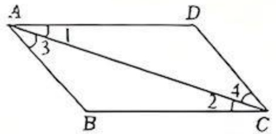

如图，已知 $AD \parallel BC$，增加以下的一个条件后能得到 $AB \parallel CD$ 的是（ ）

A. $\angle B = \angle D$

B. $\angle 1 = \angle 2$

C. $\angle 1 = \angle 3$

D. $\angle D + \angle DCB = 180^{\circ}$

> [!question]- 点击查看答案与解析
> 【答案】A
> 
> 【考点】平行线的判定与性质 → [[【初中数学知识点体系-人教版】#7-2 平行线]]
> 
> 【解析】
> 已知$AD \parallel BC$，根据平行线性质：
> - 选项A：若$\angle B = \angle D$，由$AD \parallel BC$得$\angle D + \angle DCB = 180^\circ$，则$\angle B + \angle DCB = 180^\circ$，根据"同旁内角互补，两直线平行"，可得$AB \parallel CD$，此选项正确；
> - 选项B：$\angle 1 = \angle 2$只能推出$AD \parallel BC$（内错角相等，两直线平行），无法得到$AB \parallel CD$，此选项错误；
> - 选项C：$\angle 1 = \angle 3$只能推出$AD \parallel BC$，无法得到$AB \parallel CD$，此选项错误；
> - 选项D：$\angle D + \angle DCB = 180^\circ$是$AD \parallel BC$的性质，而非$AB \parallel CD$的判定条件，此选项错误。
> 
> 【易错点】混淆平行线的判定条件与性质，错把性质当判定。
